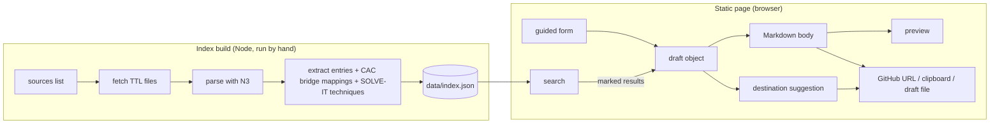

# CASE/UCO Change Request Helper Prototype - Plan

## Goal Capsule

- **Objective:** a working proof-of-concept static page that guides a submitter, in plain language, through writing a CASE/UCO change request, shows what already exists in CASE/UCO and in the SOLVE-IT and Crimes Against Children (CAC) extensions, and hands the finished text to GitHub's new-issue page.
- **Authority:** this plan's Product Contract, then its Key Technical Decisions, then the code it borrows from FOCAL (`~/dev/FOCAL`, read-only reference, not a dependency).
- **Stop conditions:** stop and ask if GitHub's pre-filled issue URL cannot carry a body at all, or if an upstream source has moved so that the index cannot be built from the URLs below.
- **Execution profile:** one prototype, no hosting, no scheduled rebuild. Plain HTML, CSS and JavaScript modules in the browser; Node only for the index-build script and tests.
- **Tail ownership:** the project folder is not a git repository yet. Do not create commits, a remote or a GitHub Pages deployment unless the user asks.

---

## Product Contract

### Summary

A single static page with a guided form for each change-request section, worked examples, a live Markdown preview, a search over existing concepts (grouped as CASE/UCO and as extensions), existing-issue search links, and a final step that picks UCO or CASE as the destination and opens a pre-filled GitHub issue. A Node script builds the search index from the upstream ontologies.

### Problem Frame

Coverage is one of the obstacles to CASE/UCO adoption, and gaps are reported through the change-request issue template (`.github/ISSUE_TEMPLATE/change-request.md` in `ucoProject/UCO`; `casework/CASE` has its own). The template is written for the Ontology Committee: it asks for numbered requirements, competency questions with expected results and ground-truth positive and negative cases, a risk analysis and a solution suggestion, mostly explained inside HTML comments. A practitioner who has noticed that something cannot be represented has to learn the template's vocabulary, and usually does not know whether the concept already exists in CASE/UCO or in an extension. The SOLVE-IT TRWM helper showed that a guided form with examples and draft files lowers this barrier.

### Requirements

- R1. The form asks for each section of the change-request template in plain language: background (what, for whom, why), requirements, benefits, risks, competencies, solution suggestion, and permission for examples to be transcribed.
- R2. Requirements and competencies are repeatable: "Add requirement", "Add competency" and, within a competency, "Add question" buttons add a new block; blocks can be removed.
- R3. Each section shows a short explanation and a worked example. The competency example uses the template's own camera versus extraction-kiosk scenario.
- R4. The risks section has a checkbox for "I am not aware of any risks", which inserts the template's suggested sentence.
- R5. A live preview shows the exact Markdown that will be filed, structured with the template's headings (`# Background`, `## Requirement 1`, `### Competency Question 1.1`, `#### Result 1.1`, and so on).
- R6. A search box finds existing classes, properties and SOLVE-IT techniques by keyword, and shows results in two groups: "Already in CASE/UCO" and "In extensions (SOLVE-IT, CAC)".
- R7. The submitter can mark search results as related; marked results appear in a "Related existing concepts" section of the issue, and can optionally be referred to in the solution suggestion.
- R8. Each search result, and the draft title, offers a link that searches existing GitHub issues (open and closed) in UCO and CASE for that term, so duplicates can be found.
- R9. A final step chooses UCO or CASE as the destination. It defaults to UCO, suggests CASE when the marked or top results are mainly CASE concepts, and explains in plain words what each repository covers and where the request will be filed.
- R10. "Open on GitHub" opens the destination's new-issue page with the title, body and `change request` label pre-filled. "Copy to clipboard" is always available, and is the main action when the body is too long for a URL.
- R11. The draft can be saved to a file and loaded back; an unsaved draft survives a page reload in the same browser.
- R12. A Node script builds the search index from UCO/CASE 1.5.0, the SOLVE-IT ontology and knowledge base, and the CAC ontology modules.

### Scope Boundaries

- The prototype covers requests for an entirely new concept only. Requests to correct an existing class or property, or to extend one (for example a new property on an existing class), follow a different path that starts from the existing concept, and are deferred. When the submitter marks a CASE/UCO result as related, the page notes that if that concept nearly fits, a correction or extension request may be more appropriate, and that this tool does not yet guide one.
- No backend, no sign-in handling, no filing through the GitHub API: the submitter files from their own GitHub account on GitHub's page.
- No links to FOCAL (the user decided against them).
- No AI drafting help and no search by meaning (embeddings); keyword search only.
- CAC example knowledge graphs (`examples_knowledge_graphs/`, `analytics_demonstration/`) are never fetched or indexed: several appear to be based on real cases. CAC `-shapes.ttl` files are not indexed.
- SOLVE-IT weaknesses, mitigations, citations and objectives are not indexed.

#### Deferred to Follow-Up Work

- A separate guided path for correcting or extending an existing CASE/UCO concept, starting from a search result rather than from a blank form.
- Scheduled (nightly) rebuild of the index, locally or as a GitHub Action, including an "only rebuild when upstream changed" check.
- Hosting (for example GitHub Pages) and a decision on which organisation hosts it.
- Raising the added "Related existing concepts" section with the Ontology Committee before promoting the tool.
- Letting Project VIC know, as their licence file requests, if the tool is made public.

### Outstanding Questions

- Deferred: whether GitHub applies the `labels` URL parameter for submitters without triage rights on the repository. Check during U4; the body is the part that matters.
- Deferred: the practical maximum URL length GitHub accepts for a pre-filled issue. Set the threshold during U4 by testing; start at 8,000 characters of encoded URL.
- Deferred: whether passing `template=change-request.md` together with `body` keeps the body or replaces it with the template. Check during U4; omit `template` if it interferes.

### Sources

- UCO template: `https://github.com/ucoProject/UCO/blob/master/.github/ISSUE_TEMPLATE/change-request.md` (read 2026-10-29).
- FOCAL source list, parser, index builder and search: `~/dev/FOCAL/src/store/config.js`, `src/utils/rdfParser.js`, `src/utils/prefixes.js`, `src/utils/search.js`, `src/store/ontologyStore.js` (`rebuildEntityIndex`), and issue-search URL logic in `src/components/EntityDetail.jsx`.
- SOLVE-IT knowledge base TTL: `https://raw.githubusercontent.com/SOLVE-IT-DF/solve-it-ontology/main/docs/data/solve-it-kb.ttl`. Techniques are declared as `a owl:Class, solveit-core:Technique` with `rdfs:label`, `solveit-core:techniqueDescription` and `solveit-core:hasCASEInputClass` / `hasCASEOutputClass`.
- CAC ontology: `Project-VIC-International/CAC-Ontology`, v3.1.0 (2026-08-09), Apache 2.0; bridge files `ontology/cacontology-bridge-uco.ttl` and `cacontology-bridge-case.ttl`.

---

## Planning Contract

### Key Technical Decisions

- KTD1 (no build step for the page). Plain HTML, CSS and ES modules, no framework or bundler. (session-settled: user-directed — chosen over a React/Vite app like FOCAL: the page is one form and should be easy for the community to maintain.) Because ES modules and `fetch` do not work from `file://`, the page is served locally (for example `python3 -m http.server`) during the prototype.
- KTD2 (index built ahead of time, not in the browser). A Node script fetches and parses the TTL files and writes one JSON index (`data/index.json`), which is committed. The page reads only that file and needs no RDF library. (session-settled: user-approved — chosen over parsing in the browser as FOCAL does, and over a Python/rdflib script: Node lets FOCAL's parser and index code be reused.) FOCAL code is copied into this project, not imported, so FOCAL changes cannot break it.
- KTD3 (sources). Start from FOCAL's source list, pinned to UCO and CASE 1.5.0. Drop the UCO/CASE master files (imports only), CASE facet cardinalities, the vulnmaster AI-generated extensions, and all `-shapes.ttl` files. Keep the SOLVE-IT ontology modules (the user asked for the SOLVE-IT ontology to be searched) and, from the SOLVE-IT knowledge base, techniques only (session-settled: user-approved — chosen over also indexing weaknesses and mitigations, which would mostly add noise).
- KTD4 (index entry shape). Mirror FOCAL's entity entry (IRI, short name, compact IRI, type, label, comment, source group) and add: `tier` (`core` for UCO/CASE, `extension` for SOLVE-IT and CAC), `repo` for core entries (`ucoProject/UCO` or `casework/CASE`), `mapsTo` for CAC classes whose bridge files declare `rdfs:subClassOf` or `owl:equivalentClass` to a UCO/CASE IRI, and, for SOLVE-IT techniques, the technique description as the comment and the CASE input/output classes.
- KTD5 (search). Port FOCAL's substring scoring, but split the query into words and rank by how many words match, weighting short name and label above comment. FOCAL's version matches the whole query as one string, which fails for phrases such as "drone flight log".
- KTD6 (destination). Searching always covers both UCO and CASE. The destination defaults to UCO; the page suggests CASE when most of the marked results (or, if none are marked, the top five core results) come from CASE. Extension results never change the destination. (session-settled: user-directed — chosen over asking for the destination at the start.)
- KTD7 (issue hand-off). Build `https://github.com/<repo>/issues/new?title=…&body=…&labels=change+request`. When the encoded URL is over the threshold, the page says so, makes "Copy to clipboard" the main action, and the GitHub button opens the page with the title only.
- KTD8 (drafts). The draft is one plain object; save writes it as JSON with a `schemaVersion` field, load validates it and reports what could not be read. Autosave to `localStorage` is a convenience only, wrapped so the page works when storage is unavailable.
- KTD9 (tests). Node's built-in test runner (`node --test`), with no test framework. Logic lives in modules that do not touch the DOM so it can be tested directly; the DOM layer is checked in a browser.

### High-Level Technical Design



### Output Structure

```text
index.html
assets/styles.css
src/app.js                 # DOM wiring only
src/lib/draft.js           # draft object, save/load, autosave
src/lib/markdown.js        # draft -> issue body
src/lib/search.js          # keyword search over the index
src/lib/destination.js     # UCO/CASE suggestion and explanation
src/lib/github.js          # issue URL, length check, issue-search URLs
src/content/guidance.js    # prompts, explanations, worked examples
data/index.json            # generated, committed
scripts/build-index.mjs
scripts/lib/sources.js     # adapted from FOCAL config.js
scripts/lib/parse.js       # adapted from FOCAL rdfParser.js
scripts/lib/prefixes.js    # copied from FOCAL prefixes.js
scripts/lib/extract.js     # adapted from FOCAL rebuildEntityIndex
tests/                     # one *.test.js per lib module, plus fixtures/
package.json               # n3 only; "test" and "build-index" scripts
README.md
```

---

## Implementation Units

### U1. Index build script

**Goal:** produce `data/index.json` from the upstream ontologies.
**Requirements:** R6, R12; KTD2, KTD3, KTD4.
**Dependencies:** none.
**Files:** `package.json`, `scripts/build-index.mjs`, `scripts/lib/sources.js`, `scripts/lib/parse.js`, `scripts/lib/prefixes.js`, `scripts/lib/extract.js`, `tests/extract.test.js`, `tests/fixtures/*.ttl`, `data/index.json`.
**Approach:** adapt FOCAL's source list to KTD3 and add `tier` and `repo` to each source. Replace FOCAL's sessionStorage cache with a plain fetch. Extraction follows FOCAL's `rebuildEntityIndex` (classes, properties, named individuals; first source wins per IRI), then adds SOLVE-IT techniques and CAC bridge mappings per KTD4. A source that fails to fetch or parse is reported and skipped; the script exits non-zero only if no core source succeeds. The index records the build date and each source's declared version (FOCAL's `ontologyVersion.js` logic).
**Patterns to follow:** FOCAL files listed under Sources.
**Test scenarios:**
- A fixture with one `owl:Class` carrying label and comment yields one `class` entry with both fields and the right `tier` and `repo`.
- A fixture with an object property and a datatype property yields two `property` entries.
- A SOLVE-IT fixture with one technique, one weakness and one mitigation yields only the technique, with its description as comment and its CASE input/output classes.
- A CAC bridge fixture declaring `cac:X rdfs:subClassOf uco-core:UcoObject` gives the CAC entry `mapsTo: ["uco-core:UcoObject"]`; a subclass statement pointing at another CAC class adds nothing.
- The same IRI declared in two sources produces one entry, from the first source.
- A blank-node subject is ignored.
- A source whose fetch fails is listed as failed and the remaining sources are still indexed.
**Verification:** running the script against the live sources writes an index containing entries from all four groups, with no CAC example-graph or shapes URL in the fetched list.

### U2. Draft object and Markdown generation

**Goal:** turn the form's state into the issue body, and save and load it.
**Requirements:** R1, R2, R4, R5, R7, R11; KTD8.
**Dependencies:** none.
**Files:** `src/lib/draft.js`, `src/lib/markdown.js`, `tests/draft.test.js`, `tests/markdown.test.js`.
**Approach:** the draft holds title, background, a list of requirements, benefits, risks plus a "no known risks" flag, a list of competencies (each with scenario and a list of question/result pairs), solution suggestion, the transcription-permission flag, marked related concepts and the destination. Markdown follows the template's heading structure and numbering, and omits empty optional blocks rather than printing empty headings. Related concepts are rendered as a list grouped by tier, each with compact IRI, label and source.
**Test scenarios:**
- Two requirements render as `## Requirement 1` and `## Requirement 2` in order; removing the first renumbers the second to 1.
- Competency 2 with two questions renders `### Competency Question 2.1`, `#### Result 2.1`, `### Competency Question 2.2`, `#### Result 2.2`.
- The "no known risks" flag with an empty risks box renders the template's sentence; with text in the box, the text is used.
- The transcription flag renders "I am fine with my examples being transcribed and credited"; unset, nothing is rendered.
- Marked related concepts render under "Related existing concepts", CASE/UCO first, then extensions; no marked concepts means no section.
- Saving and loading a draft round-trips to an equal object.
- Loading a file with a missing `schemaVersion`, invalid JSON, or wrong field types is rejected with a message, and the current draft is unchanged.
**Verification:** a full example draft produces Markdown that matches the template's structure when compared side by side.

### U3. Search and destination suggestion

**Goal:** keyword search over the index, and the UCO/CASE suggestion.
**Requirements:** R6, R9; KTD5, KTD6.
**Dependencies:** U1 (index shape).
**Files:** `src/lib/search.js`, `src/lib/destination.js`, `tests/search.test.js`, `tests/destination.test.js`.
**Approach:** search returns results split into core and extension tiers, each capped (for example 20). The destination function takes marked results (or top core results) and returns the suggested repository plus a short reason, using the explanations in `src/content/guidance.js`.
**Test scenarios:**
- "file" ranks an entry whose short name starts with "File" above one that only mentions "file" in its comment.
- "drone flight log" matches an entry containing all three words above one containing only "log".
- Matching is case-insensitive; an empty or whitespace-only query returns no results.
- Results are split by tier: a CAC entry never appears in the core group.
- No marked results and no query gives UCO with the default reason.
- Three marked CASE results and one UCO result suggests CASE; two and two stays UCO.
- Marked SOLVE-IT and CAC results alone leave the destination at UCO.
**Verification:** searching the real index for "mobile device", "chain of custody" and "grooming" returns sensible results in the expected tier.

### U4. GitHub hand-off

**Goal:** issue URL, length handling and existing-issue search links.
**Requirements:** R8, R10; KTD7.
**Dependencies:** U2.
**Files:** `src/lib/github.js`, `tests/github.test.js`.
**Approach:** pure functions build the new-issue URL for a repository, report whether it is over the threshold, build a title-only fallback URL, and build `https://github.com/<repo>/issues?q=is%3Aissue%20<term>` for a term (FOCAL's `getIssueSearchUrl`). Resolve the three deferred questions under Outstanding Questions by testing against GitHub in a browser, and record the outcome in `README.md`.
**Test scenarios:**
- Title and body containing `&`, `#`, `?`, line breaks and non-ASCII characters survive encoding (decode and compare).
- The URL includes `labels=change+request` and targets the chosen repository.
- A body that pushes the URL over the threshold is reported as too long, and the fallback URL contains the title but no body.
- An issue-search URL for "MobileDevice" targets the right repository and searches both open and closed issues.
**Verification:** a short draft opens on GitHub with title and body filled in; a long draft triggers the clipboard path.

### U5. The page

**Goal:** the guided form, preview, search panel, destination step and output buttons.
**Requirements:** R1–R11; KTD1, KTD8.
**Dependencies:** U2, U3, U4.
**Files:** `index.html`, `assets/styles.css`, `src/app.js`, `src/content/guidance.js`.
**Approach:** one page, sections in template order, each with a plain-language prompt, a one-line "why the committee asks this", and a collapsible worked example. The search panel sits beside the form on wide screens and below it on narrow ones; each result has "Mark as related" and "Search existing issues" controls. The final step shows the destination suggestion and explanation, lets the submitter change it, and shows the output buttons. The preview updates on input. Light and dark colour schemes, labelled controls, visible focus, keyboard-operable add/remove buttons. If the index fails to load, the form still works and the search panel says why.
**Patterns to follow:** the TRWM SOLVE-IT Helper's guided-form approach (examples beside fields, draft files).
**Test scenarios:** Test expectation: none -- DOM wiring only; behaviour is covered by U2–U4 tests and the browser walkthrough under Verification Contract.
**Verification:** the browser walkthrough below passes.

### U6. README

**Goal:** explain what the tool is, how to rebuild the index, how to run it locally, and what was found about GitHub URL behaviour.
**Requirements:** R12.
**Dependencies:** U1, U4.
**Files:** `README.md`.
**Approach:** short, British English, with the AI-generated note and credits in the same form as FOCAL's README. State the CAC exclusions and the Apache 2.0 attribution.
**Test expectation:** none -- documentation.
**Verification:** a reader can rebuild the index and start the page by following it.

---

## Verification Contract

- `npm test` (Node's test runner over `tests/`) passes.
- `npm run build-index` completes against the live sources and reports per-source counts; the fetched URL list contains no `examples_knowledge_graphs`, `analytics_demonstration` or `-shapes.ttl` paths.
- Browser walkthrough with the page served locally: fill every section using the worked examples; add and remove a requirement and a competency question; search, mark one CASE/UCO and one extension result; confirm the preview, the destination suggestion and its explanation; save the draft, reload the page, load the draft back; open on GitHub (check title, body and label on GitHub's page, then close without submitting); copy to clipboard. No console errors.
- Nothing is submitted to GitHub during verification.

## Definition of Done

- All requirements R1–R12 are met and the Verification Contract passes.
- The three deferred GitHub questions have recorded answers in `README.md`.
- `data/index.json` is present and was built from the sources in KTD3.
- No code from abandoned approaches remains; no unused FOCAL code was copied.
